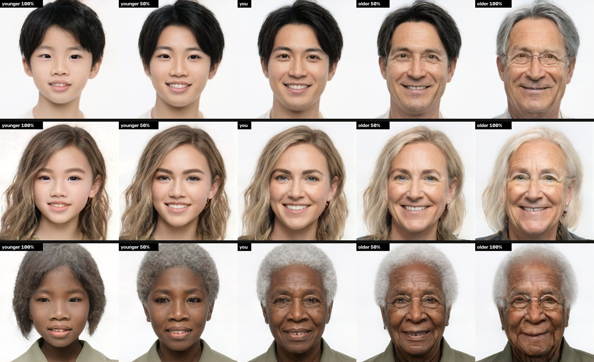
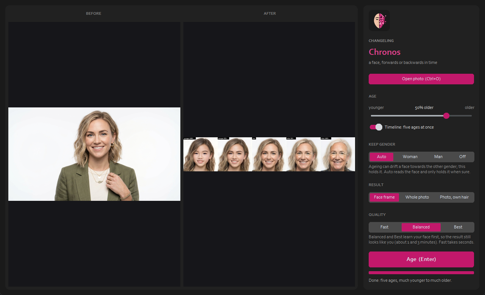

[](https://x.com/NorowaretaGemu)
[](LICENSE)

<div align="center">
  <a href="https://ko-fi.com/cursedentertainment">
    
  </a>
</div>

<p align="center"></p>

# Changeling Chronos

**Website:** https://cursedprograms.github.io/Changeling-Chronos/



*Part of the Changeling family, all together in [Changeling Studio](https://github.com/CursedPrograms/Changeling-Studio):
[CopyCat](https://github.com/CursedPrograms/Changeling-CopyCat) (face swap, photos and video) ·
[CopyCat Realtime](https://github.com/CursedPrograms/Changeling-CopyCat-Realtime) (face swap, live) ·
[Tiresias](https://github.com/CursedPrograms/Changeling-Tiresias) (gender) · **Chronos** (age) ·
[Natio](https://github.com/CursedPrograms/Changeling-Natio) (where in the world) ·
[Cosmetics](https://github.com/CursedPrograms/Changeling-Cosmetics) (makeup, hair, beards).*

Age a face forwards or backwards in a photo: slide towards younger or older, or make a **timeline** of five
ages at once. Named after Chronos, time itself. Every face above is an AI-generated person who doesn't exist;
use it on yourself, on generated people, or on people who agreed.

## Use it

Python 3.9 - 3.12 and an NVIDIA GPU (4 GB is enough). Start the launcher for your shell; the first run
makes the `psdenv` virtual environment, installs `requirements.txt` and fetches the models. If
[Changeling Tiresias](https://github.com/CursedPrograms/Changeling-Tiresias) is next to it (`..\Changeling-Tiresias`),
Chronos uses its models instead of downloading the same 1.3 GB again.

```
run.bat                                   # Windows: the window
.\run.ps1                                 # PowerShell
./run.sh                                  # Linux / macOS / Git Bash
run.bat photo.jpg --age 0.6               # 60% older, without the window
run.bat photo.jpg --age -0.5              # 50% younger
run.bat photo.jpg --timeline              # five ages side by side
```

### The window




Changeling's look: **Before** and **After** side by side, the controls on the right.

| Control | Does |
| --- | --- |
| **Open photo** (<kbd>Ctrl</kbd>+<kbd>O</kbd>) | a photo with a face |
| **Age** slider | younger ← as you are → older |
| **Timeline** | five ages at once (much younger, younger, you, older, much older) from one run |
| **Keep gender** | Auto, Woman, Man, Off: ageing in this model can drift a face towards the other gender; this holds it |
| **Result** | the aged face frame (default), the whole photo, or the photo with its own hair |
| **Quality** | Fast (seconds), Balanced and Best (learn your face first, about 1 and 3 minutes) |
| **Age** (<kbd>Enter</kbd>) | runs it, with a completion bar while it learns your face |
| **Save** (<kbd>Ctrl</kbd>+<kbd>S</kbd>), **Close-up** | save the result; the photo, its reconstruction and the result side by side |

### Command line

| Option | Meaning |
| --- | --- |
| `--age` | -1 (much younger) .. +1 (much older); default 0.5 |
| `--timeline` | five ages side by side instead of one |
| `--keep-gender auto\|female\|male\|off` | hold the face's gender while ageing (auto: only when FairFace is sure) |
| `--quality fast\|balanced\|best` | `fast` = encoder only; `balanced` / `best` learn the face first (100 / 250 steps) |
| `--whole-photo`, `--keep-hair` | paste back into the whole photo (with `--keep-hair`, only the face) |
| `-o` | the output file (one input only) |

## How it works

1. **Detect and align** the face with OpenCV YuNet, cropped the way FFHQ (StyleGAN2's training set) was.
2. **Invert** it into StyleGAN2's W+ latent space with the [e4e](https://github.com/omertov/encoder4editing) encoder.
3. **Pivotal tuning** ([PTI](https://github.com/danielroich/PTI)): briefly fine-tune the generator on the face so the result still looks like it (skipped at Fast).
4. **Edit**: move the latent along a learned age direction ([source](https://github.com/a312863063/generators-with-stylegan2)).
5. **Keep gender**: in this generator age and gender are tangled (an old woman aged further starts to look like
   a man), though their two directions are nearly at right angles. So FairFace reads each result, and one that
   has drifted is nudged back along the gender direction until it reads as the original again.

Known limit: the youngest end can drift a face's ethnicity (age and ethnicity are tangled the same way); a
keep for that is planned.

## Licenses

The code is MIT (e4e and rosinality's stylegan2-pytorch are MIT). The pretrained StyleGAN2 FFHQ weights are
under NVIDIA's non-commercial license, so this is for personal and research use.

---

<br>
<div align="center">
© Cursed Entertainment 2026
</div>
<br>
<div align="center">
<a href="https://cursed-entertainment.itch.io/" target="_blank">
    
</a>
</div>
<br>
<div align="center">
  <a href="https://github.com/SynthWomb" target="_blank">
    
  </a>
</div>
